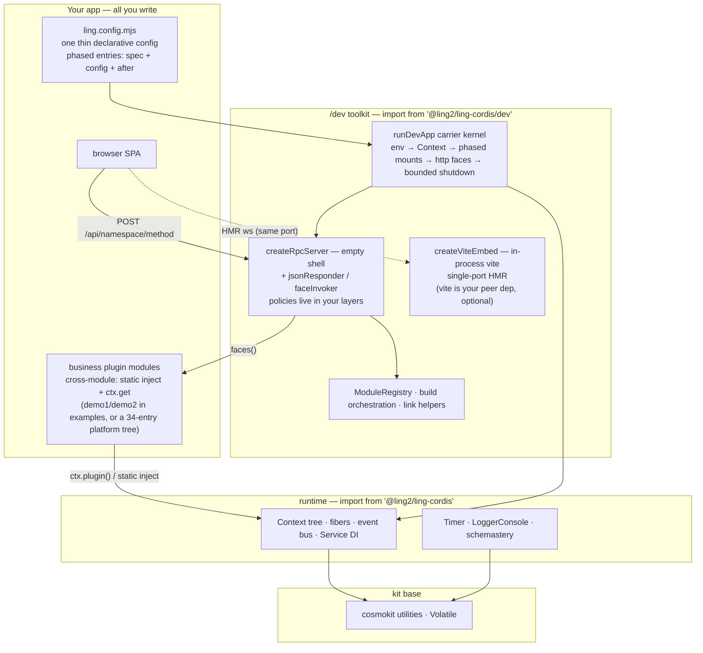

# ling-cordis

A standalone [cordis](https://github.com/koishijs/cordis)-lineage plugin runtime for TypeScript: composable **contexts**, lifecycle-managed **plugin fibers**, a typed **event bus**, **dependency-injected services**, **timer** mixins, **schema** validation (schemastery), and console **logging** — shipped as one dependency-free-to-consume ESM package.

> 简体中文文档见 [README.zh-CN.md](./README.zh-CN.md)。

## Features

- **Context tree** — proxy-based dependency container with prototypal scoping (`extend`, `isolate`, `intercept`).
- **Fibers** — every plugin runs in a fiber with epoch-based reload/unload, effect disposal, and config validation.
- **Event bus** — five dispatch modes (`emit` / `parallel` / `serial` / `bail` / `waterfall`) with typed event maps via module augmentation.
- **Services** — named APIs on `ctx` (`ctx.get(name)`), `@Inject()` decorator, callable services, intercept chains.
- **Timer** — `ctx.timeout` / `interval` / `throttle` / `debounce`, all owned by the surrounding fiber and disposed with it.
- **Schema** — the schemastery builder: declarative config schemas, standard-schema v1 interface, `Volatile` stable-reference configs.
- **Console logger** — leveled logging with colors, diff suffixes, and per-name palette.

## Architecture

Four layers — you only ever write the top one; the other three ship in this package:



- **Your app** — one config file plus plugin modules; cross-module calls are plain `static inject` + `ctx.get` (backend) and namespace swapping (frontend).
- **/dev toolkit** — everything a dev server needs around the runtime: carrier kernel, JSON-RPC gateway, vite HMR bridge, registry/build/link helpers.
- **runtime** — the cordis-lineage core this package ships as.
- **kit** — dependency-free utilities the runtime builds on.

## Requirements

- Node.js **≥ 22** (uses `Promise.withResolvers`)
- ESM only (`"type": "module"`); the browser logger entry ships as source but is not part of the published entry

## Install

```bash
npm install @ling2/ling-cordis
# or: pnpm add @ling2/ling-cordis
```

## Quick start

```ts
import { Context, LoggerConsole, Service, Timer } from '@ling2/ling-cordis'

// A plugin is a service named 'hello' exposed as ctx.hello
class Hello extends Service {
  static inject = [] as const
  constructor(ctx: Context) {
    super(ctx, 'hello')
    // timer mixins arrive with the Timer plugin; effects are
    // disposed together with the owning fiber
    ctx.setInterval(() => ctx.logger('hello').info('tick'), 1000)
  }
  greet(name = 'world') {
    return `hello, ${name}!`
  }
}

const ctx = new Context()
await ctx.plugin(LoggerConsole, { colors: false })
await ctx.plugin(Timer)
await ctx.plugin(Hello)

ctx.logger('app').info(ctx.get('hello').greet('cordis'))
await ctx.fiber.dispose() // runs every registered effect
```

A runnable version lives in [`examples/hello`](./examples/hello) (`pnpm smoke`).

## Dev kit (`/dev`)

The `/dev` subpath ships the assembly-and-workflow toolkit behind a real
`pnpm dev` / `pnpm build` experience — one registry drives module mounting, the
static bundle table, and build orchestration; an **in-process, single-port**
vite embed gives your dev server frontend HMR (React Fast Refresh included)
without a second port or a child process:

```ts
import { ModuleRegistry, buildRegisteredModules, createViteEmbed } from '@ling2/ling-cordis/dev'

// 1) one registry, three consumers (mounting / static table / builds)
const registry = new ModuleRegistry(['core', 'tail'])
registry.add({
  id: 'my-plugin', phase: 'tail', note: 'example module',
  client: { key: 'my-plugin/client.js' },        // → static bundle table entry
  mount: async (ctx, env) => { await ctx.plugin(MyPlugin, { env }) },
})
for (const mod of registry.ofPhase('core')) await mod.mount?.(ctx, env)

// 2) in-process vite HMR (same process, same port): vite loads as a library
//    from cwd/node_modules in middlewareMode — its HMR websocket rides YOUR
//    http server; missing/foreign vite rejects (fail loud, no silent dist
//    fallback; the enabled:false escape hatch stays yours to compose)
const embed = await createViteEmbed({ cwd: 'web-app', httpServer, react: true })
server.on('upgrade', (req, socket) => {
  if (embed.claimsUpgrade(req)) return          // vite-hmr protocol + base path = vite's
  socket.destroy()
})
// hand /app/* to embed.middlewares on your http face (next() = unclaimed; error loudly, never fall back)

// 3) registry-driven builds: full / targeted / carrier target / skipCarrier
buildRegisteredModules({ registry, rootDir, carrier: { id: 'web', cwd: 'web-app', script: 'build' } })
```

Claim order stays yours: the embed never owns your server — your http face and
upgrade chain stay in front, and vite only receives the `/app` pages it claims
plus its HMR websocket upgrades. vite (and `@vitejs/plugin-react` when
`react: true`) is your peer dependency; the package adds none.

**Or skip the wiring entirely** — `runDevApp` turns one declarative config into
the whole dev server (a `vite.config.ts`-style experience):

```ts
import { defineApp, runDevApp } from '@ling2/ling-cordis/dev'

const config = defineApp({
  rootDir: import.meta.dirname,
  port: 3000,
  hmr: { cwd: 'web-app', react: true },   // in-process single-port vite; zero vite.config (see below)
  staticApp: { root: 'web-app/dist' },    // product form only (dev /app goes to vite, never falls back)
  phases: ['base', 'core', 'engine', 'tail'],
  modules: [
    { id: 'my-plugin', phase: 'tail', spec: './src/my-plugin.ts',
      client: { key: 'my-plugin/client.js' }, config: { port: 1 } },
  ],
  http: (ctx) => [{ handle: myGateway(ctx), healthz: () => ({ faces: 3 }) }],
})
await runDevApp(config) // env → Context → phases loop → http + HMR + static → bounded shutdown
```

Entries mount via dynamic `import(spec)` + `ctx.plugin` (`use: 'default'` for
class plugins), complex wiring goes in `after` hooks, and `loadEnv` / registry /
build / link helpers round out the kit. The kernel reads no environment
variables — switches and ports arrive as plain config values.

**`phases` = the mount-phase table**: it declares the phase order, each entry
picks its phase via the `phase` field, and the kernel mounts phase by phase
(registration order within a phase). Ordering conventions like "base before
business, engines after core" are expressed through the table — phase names
are free-form (the example uses `base/core/engine/tail`; a single `['only']`
for small apps, or `['engine']` in `ling-harness-runner`, are equally common).
Cross-phase dependencies never rely on ordering: a plugin's `static inject`
gets wait semantics that decouple dependencies from mount order (see
`examples/dev-app`, where demo2 in the tail phase depends on demo1 in core).

A complete runnable demo lives in [`examples/dev-app`](./examples/dev-app):
`pnpm demo` boots it (open http://127.0.0.1:8390/), `pnpm demo:check`
self-tests the whole chain (login → RPC arg binding → session gate → healthz →
static SPA) and exits — that one command is the fastest way to judge the
experience.

### Frontend HMR (in-process vite, single port)

One `hmr` line plus two host-page lines is the whole integration:

- **Config side**: `hmr: { cwd: <vite project root>, react: true }` — the
  framework loads `@vitejs/plugin-react` from your cwd (peer-dep contract:
  missing/foreign rejects), synthesizes `base: '/app/'` and dep prewarming
  (convention probe `src/client/index.tsx|.ts`) — **zero vite.config for simple
  consumers**. Complex consumers (alias families) bring their own
  `vite.config.ts` and merge naturally — then leave `react: true` off
  (double plugin = duplicate registration).
- **Host page side** (ling-web shape = the standard project shape):
  `index.html` references exactly one module entry,
  `<script type="module" src="/src/shell.ts">`; `shell.ts` (the same six lines
  everywhere — see the next section, "Standard project layout") runtime-imports
  `/__ling/boot.js` and then calls `lingLoadPanels(['my-plugin/client.js'])`.
  Zero-build host pages may use the two-line form: `<script
  src="/__ling/boot.js"></script>` + an inline
  `<script>lingLoadPanels(['key'])</script>` — the framework loader ships the
  panel-protocol load face (default `window.__ModuleLoader__.load({id, factory})`,
  never clobbering a host's own loader) and the runtime-dynamic-import path;
  both shapes share the same load face. **Do not** reference panels via
  `<script src="/packages/…">` or static `import`: in dev, vite's html
  transform prefixes root-relative URLs with the base (`/app/packages/*` is
  aliased as a safety net) and inline module scripts get extracted into
  html-proxy modules the middleware-mode vite does not serve.
- **Panel side**: registry entries with `client: { key }` and the convention
  entry (`src/client/index.tsx|.ts`) → in dev, `/packages/<key>` serves an ESM
  shim (browser pulls source through `/app/@fs/`, React Fast Refresh applies);
  product form serves the built bundle unchanged.
- **Semantics notes** (verified on real machines): ①components and the
  `apply`/`inject` protocol exports must live in separate modules — a mixed
  module hot-reloads via remount (state lost); ②React `StrictMode` makes the
  **first** hot update after page load remount once; ③without dep prewarming
  the first page load races vite's optimizer cold start (the convention probe
  is on by default for exactly this).

A runnable sample lives in [`examples/hmr-react`](./examples/hmr-react) — the
ling-web shape (a standard `vite.config.ts` plus the standard project trio,
after `pnpm install --ignore-workspace` inside the package):

| Command | Role |
| --- | --- |
| `pnpm dev` | Dev environment (HMR): in-process single-port vite; open `/app/` and edit `src/client/DemoPanel.tsx` for instant hot updates; `--check` runs the 4-probe self-test |
| `pnpm build` | Compile two artifacts: the shell `dist/` (vite build) + the panel `client/client.js` (the framework's `buildClientBundle` wraps it as a panel-protocol registrator) |
| `pnpm start` | Boot the build output — no vite, same page and same load face; `--check` self-test |

Another reference consumer is `ling-harness-runner` (container shape: same
trio and source-direct conventions as the sample — `pnpm start` boots the
product form from the same source via `--product`, no bundle artifact; the
zero-vite-config form (`react: true`) currently has no standalone sample —
the capability stays, simple consumers use it per the config-side notes above).

### Build & checks (one-line integrations too)

- **Panel bundle**: `buildClientBundle({ entry, id })` — esbuild bundles the panel
  source into a single-file cjs wrapped as the **panel-protocol registrator**
  (charset, require shim, and load face all built in; esbuild is your peer
  dep — missing fails loud). Default output `<pkg>/client/client.js`.
- **Build orchestration**: `buildRegisteredModules({ registry, rootDir, carrier })`
  — per-package `build:client` plus a carrier target (the shell `vite build`
  producing dist); `examples/hmr-react`'s `pnpm build` is the full-chain sample.
- **Typecheck orchestration**: `runCheckScripts({ targets })` /
  `checkRegisteredModules` — runs each package's `check` script and aggregates
  a full report (failures never throw; ok/failed carry exit codes).
- **Theme gate engine**: `themeGate({ tokenSheets, bundles, allowedVars,
  allowedPrefixes, skipBundleE3Prefixes, strict })` — E1 ghost tokens / E2
  hardcoded theme defines / E3 light-bg warnings / strict hardcoded colors;
  `stripCommentsLine` and `printThemeGateResult` are exported for consumer-side
  strict source scans (the bsh tree's theme-guard is the reference consumer:
  policy allowlists local, engine from the framework).
- **Path discipline**: everything goes through `node:path` / `pathToFileURL`
  (Linux/Windows compatible; no drive-letter string concatenation). The
  build-output startup archetype is `ling-harness-runner`
  (`pnpm dev` / `pnpm build` / `pnpm start`).

**The gateway is an empty shell; every policy is your layer.** `createRpcServer`
is koa-style onion composition only — no routes, no protocol shapes, nothing
auto-mounted. Compose explicit layers: the mechanical pieces shipped with the
package (`jsonResponder` — outermost response sink; `faceInvoker` — innermost
`POST /api/<ns>/<method>` dispatch with by-name arg binding), plus your
business layers in between (auth trio, session gate, audit, logging). Layer
order *is* the semantics: an audit layer outside the invoker rewrites the
value right before it is sent; nesting comes free (ALS-style request-context
propagation is just a middleware wrapping `next()`). Layer objects may carry
`onInit` / `onReady` / `onDestroy`, dispatched through `createRpcFace` and
`runDevApp`'s face slots. In `examples/dev-app` the whole auth trio + session
gate is ~40 lines of demo-owned middleware — that's the intended shape for
your policies.

### Standard project layout (ling-web shape)

What a standard consumer package of this framework looks like —
[`examples/hmr-react`](./examples/hmr-react) and the reference consumer
`ling-harness-runner` are **file-for-file identical**; the tree below is the
spec. New consumers start from this shape; anything diverging from it is
legacy to be reconciled (container-shape extras like `engines.json`,
`Dockerfile*`, `entrypoint.sh` are domain additions, not framework
requirements):

```
<pkg root>/
├── ling.config.mjs        # assembly declaration (single combo source): module list + phases; dev = embedded HMR, product = dist static
├── boot.mjs               # boot script: imports config → runDevApp; shared by dev/product forms; --check self-test
├── build.mjs              # pnpm build entry: viteBuild (shell dist/) + buildClientBundle (panel bundle)
├── vite.config.ts         # standard vite config (base '/app/' + react plugin) — required by complex consumers, optional for simple ones
├── index.html             # host page: single duty = #root container + <script type="module" src="/src/shell.ts">
├── src/
│   ├── shell.ts           # browser shell entry (same six lines everywhere): runtime-fetch framework loader + name panel keys
│   └── client/
│       ├── index.tsx      # panel protocol exports export { inject, apply } — the /packages source-face convention entry
│       └── DemoPanel.tsx  # pure React components and business source (separate from protocol exports = Fast Refresh keeps state)
├── dist/                  # [artifact, not committed] shell static assets (vite build; product staticApp root)
├── client/
│   └── client.js          # [artifact, not committed] panel-protocol registrator (buildClientBundle; product /packages channel)
└── package.json           # standard trio dev/build/start + peer devDeps (vite/react/esbuild/tsx)
```

Per-file roles and ownership (**convention** = path/duty fixed by the
framework, not renameable; **yours** = content owned by your business):

| File | Role | Ownership |
| --- | --- | --- |
| `ling.config.mjs` | single combo source: module list (id/phase/client/mount), the dev-form `hmr` line, product-form `staticApp` switch | path=convention, content=yours |
| `boot.mjs` | boot script: read config → `runDevApp`; `--check` self-test | same |
| `build.mjs` | `pnpm build` entry: shell + panel dual targets | same |
| `vite.config.ts` | standard vite config (`base '/app/'` + react plugin); simple consumers may omit it (`hmr.react:true` framework synthesis) | optional |
| `index.html` | host page: `#root` container + shell.ts reference; **never** inline load logic or reference panels directly | the only html, in the build graph |
| `src/shell.ts` | browser shell entry: the same six-line trigger (see below); the key list = this page's panels | path=convention, keys=yours |
| `src/client/index.tsx` | panel protocol exports `export { inject, apply }`; **never** mix in components (mixed modules hot-reload via remount, state lost) | convention entry |
| `src/client/*.tsx` | pure components and business source — the substance that hot-reloads with state | yours |
| `dist/`, `client/client.js` | the two build artifacts (shell/panel) | artifacts, not committed |

**Where `src/shell.ts` sits** (why the load action must live there instead of
`index.html`): it dodges three real-machine-verified vite traps — ① root-
relative `<script src>` gets base-prefixed by vite's html transform (→404);
② inline `type="module"` scripts get extracted into html-proxy modules that a
middleware-mode vite never serves (→500); ③ a static
`import '/__ling/boot.js'` written in source gets rewritten by vite's import
analysis. The correct path is "a local module inside the vite root (enters the
build graph, dev serves the same path, React preamble auto-injected into the
html) + a runtime dynamic import (`new Function` escape — the runtime URL
never enters the build graph)". `shell.ts` is exactly that minimal vehicle:
it runtime-fetches `/__ling/boot.js` (a framework route) to obtain
`lingLoadPanels`, then names this page's panel keys. Every consumer carries
the same lines verbatim, differing only in the key list; the loader itself
(the default `window.__ModuleLoader__` implementation + `lingLoadPanels`)
lives in the framework — consumers carry zero loading logic. Zero-build host
pages skip shell.ts and use the two-line form from the previous section —
both shapes share the same load face.

## Modules

| Path | What it is | Upstream origin |
| --- | --- | --- |
| `src/core` | contexts, fibers, events, registry, services, logger | cordis |
| `src/kit` | array/string/time/type utilities, `Volatile` mechanism | cosmokit |
| `src/schema` | callable schema builder + validation | schemastery |
| `src/plugins/timer.ts` | timer mixins plugin | cordis-plugin-timer |
| `src/plugins/logger-console` | console exporter plugin | cordis-plugin-logger-console |
| `src/dev` | dev kit: module registry, in-process vite HMR, client source face, framework loader, build orchestration | original (this repo) |

## Concepts

- **Context** — the root container and scope factory. Services, config layers, and isolation labels live on it; child scopes inherit prototypally.
- **Fiber** — one plugin activation: setup barriers, effects (disposers / promises / iterables), epoch-based `restart()` / `update()`.
- **Service** — a named singleton API on `ctx` (`ctx.get('hello')`); declare dependencies with `static inject` or the `@Inject()` decorator.
- **Events** — listeners are fiber-owned effects; augment the global `Events` interface to type your own events.
- **Schema** — describe plugin `Config` with `z.object({ port: z.number().default(3000) })`; validation runs before a fiber starts.

## Development

```bash
pnpm install
pnpm typecheck   # tsc --noEmit
pnpm test        # vitest (99 cases)
pnpm build       # tsdown (bundled JS) + tsc (per-module d.ts tree)
pnpm check:dts   # compile the external-consumer type smoke against dist/
pnpm smoke       # boot examples/hello end-to-end
```

## License & attribution

MIT — see [LICENSE](./LICENSE). This project descends from Shigma's cordis
ecosystem (via an internal `@deepseek-ai/*` fork); the full provenance chain
and module mapping live in [NOTICE.md](./NOTICE.md).
