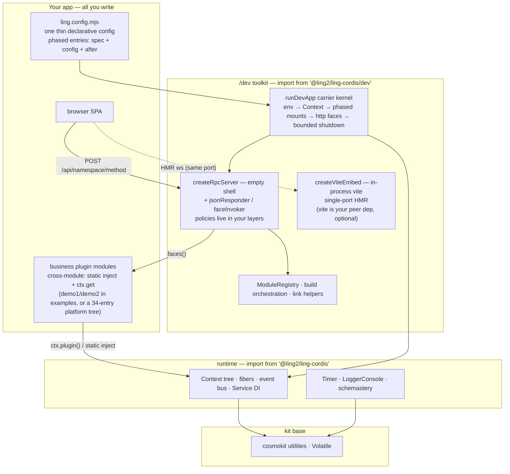

# ling-cordis

A standalone [cordis](https://github.com/koishijs/cordis)-lineage plugin runtime for TypeScript: composable **contexts**, lifecycle-managed **plugin fibers**, a typed **event bus**, **dependency-injected services**, **timer** mixins, **schema** validation (schemastery), and console **logging** — shipped as one dependency-free-to-consume ESM package.

> 简体中文文档见 [README.zh-CN.md](./README.zh-CN.md)。

## Features

- **Context tree** — proxy-based dependency container with prototypal scoping (`extend`, `isolate`, `intercept`).
- **Fibers** — every plugin runs in a fiber with epoch-based reload/unload, effect disposal, and config validation.
- **Event bus** — five dispatch modes (`emit` / `parallel` / `serial` / `bail` / `waterfall`) with typed event maps via module augmentation.
- **Services** — named APIs on `ctx` (`ctx.get(name)`), `@Inject()` decorator, callable services, intercept chains.
- **Timer** — `ctx.timeout` / `interval` / `throttle` / `debounce`, all owned by the surrounding fiber and disposed with it.
- **Schema** — the schemastery builder: declarative config schemas, standard-schema v1 interface, `Volatile` stable-reference configs.
- **Console logger** — leveled logging with colors, diff suffixes, and per-name palette.

## Glossary (unified terms)

| Term | Definition |
| --- | --- |
| **Host shell** | the resident browser shell page (`index.html` + loader) — provides only the container and the load face, no business UI |
| **Subapp** | the **sub-app** notion — the *thing being loaded*: one business package's browser half (the package's own client artifact, one JS file) that registers into the host via the subapp protocol and mounts its own UI. Compare a qiankun sub-app / a VS Code webview |
| **Slot** | the host-side **mount point** — the *place* it loads into (the dsh host's subapp/slot system): which page position a subapp occupies is decided by the slot. Subapp and slot are two different terms — do not conflate |
| **Subapp protocol** | the registration face `window.__ModuleLoader__.load({id, factory})` plus the activation contract that the factory returns `{inject, apply}` |
| **Subapp key** | the `client.key` of a ling.config.mjs module entry — the subapp's load name and `/packages` channel key; the single source of the auto-load order |
| **Loader** | the framework route `/__ling/boot.js`: default load-face implementation + `lingLoadSubapps` (for hosts with their own loader) |
| **Auto-load** | the framework route `/__ling/main.js`: the loader plus automatic `lingLoadSubapps` ordered by the module list — the standard project host page references it in one line |
| **`/packages` channel** | the subapp delivery path: dev serves a source shim (HMR applies), product serves `client/client.js` |
| **Shell/subapp artifacts** | `dist/` = the host-page static assets built by vite; `client/client.js` = the subapp registrator built by `buildClientBundle` (neither is committed) |

## Architecture

Four layers — you only ever write the top one; the other three ship in this package:



- **Your app** — one config file plus plugin modules; cross-module calls are plain `static inject` + `ctx.get` (backend) and namespace swapping (frontend).
- **/dev toolkit** — everything a dev server needs around the runtime: carrier kernel, JSON-RPC gateway, vite HMR bridge, registry/build/link helpers.
- **runtime** — the cordis-lineage core this package ships as.
- **kit** — dependency-free utilities the runtime builds on.

## Requirements

- Node.js **≥ 22** (uses `Promise.withResolvers`)
- ESM only (`"type": "module"`); the browser logger entry ships as source but is not part of the published entry

## Install

```bash
npm install @ling2/ling-cordis
# or: pnpm add @ling2/ling-cordis
```

## Quick start

```ts
import { Context, LoggerConsole, Service, Timer } from '@ling2/ling-cordis'

// A plugin is a service named 'hello' exposed as ctx.hello
class Hello extends Service {
  static inject = [] as const
  constructor(ctx: Context) {
    super(ctx, 'hello')
    // timer mixins arrive with the Timer plugin; effects are
    // disposed together with the owning fiber
    ctx.setInterval(() => ctx.logger('hello').info('tick'), 1000)
  }
  greet(name = 'world') {
    return `hello, ${name}!`
  }
}

const ctx = new Context()
await ctx.plugin(LoggerConsole, { colors: false })
await ctx.plugin(Timer)
await ctx.plugin(Hello)

ctx.logger('app').info(ctx.get('hello').greet('cordis'))
await ctx.fiber.dispose() // runs every registered effect
```

A runnable version lives in [`examples/hello`](./examples/hello) (`pnpm smoke`).

## Dev kit (`/dev`)

The `/dev` subpath ships the assembly-and-workflow toolkit behind a real
`pnpm dev` / `pnpm build` experience — one registry drives module mounting, the
static bundle table, and build orchestration; an **in-process, single-port**
vite embed gives your dev server frontend HMR (React Fast Refresh included)
without a second port or a child process:

```ts
import { ModuleRegistry, buildRegisteredModules, createViteEmbed } from '@ling2/ling-cordis/dev'

// 1) one registry, three consumers (mounting / static table / builds)
const registry = new ModuleRegistry(['core', 'tail'])
registry.add({
  id: 'my-plugin', phase: 'tail', note: 'example module',
  client: { key: 'my-plugin/client.js' },        // → static bundle table entry
  mount: async (ctx, env) => { await ctx.plugin(MyPlugin, { env }) },
})
for (const mod of registry.ofPhase('core')) await mod.mount?.(ctx, env)

// 2) in-process vite HMR (same process, same port): vite loads as a library
//    from cwd/node_modules in middlewareMode — its HMR websocket rides YOUR
//    http server; missing/foreign vite rejects (fail loud, no silent dist
//    fallback; the enabled:false escape hatch stays yours to compose)
const embed = await createViteEmbed({ cwd: 'web-app', httpServer, react: true })
server.on('upgrade', (req, socket) => {
  if (embed.claimsUpgrade(req)) return          // vite-hmr protocol + base path = vite's
  socket.destroy()
})
// hand /app/* to embed.middlewares on your http face (next() = unclaimed; error loudly, never fall back)

// 3) registry-driven builds: full / targeted / carrier target / skipCarrier
buildRegisteredModules({ registry, rootDir, carrier: { id: 'web', cwd: 'web-app', script: 'build' } })
```

Claim order stays yours: the embed never owns your server — your http face and
upgrade chain stay in front, and vite only receives the `/app` pages it claims
plus its HMR websocket upgrades. vite (and `@vitejs/plugin-react` when
`react: true`) is your peer dependency; the package adds none.

**Or skip the wiring entirely** — `runDevApp` turns one declarative config into
the whole dev server (a `vite.config.ts`-style experience):

```ts
import { defineApp, runDevApp } from '@ling2/ling-cordis/dev'

const config = defineApp({
  rootDir: import.meta.dirname,
  port: 3000,
  hmr: { cwd: 'web-app', react: true },   // in-process single-port vite; zero vite.config (see below)
  staticApp: { root: 'web-app/dist' },    // product form only (dev /app goes to vite, never falls back)
  phases: ['base', 'core', 'engine', 'tail'],
  modules: [
    { id: 'my-plugin', phase: 'tail', spec: './src/my-plugin.ts',
      client: { key: 'my-plugin/client.js' }, config: { port: 1 } },
  ],
  http: (ctx) => [{ handle: myGateway(ctx), healthz: () => ({ faces: 3 }) }],
})
await runDevApp(config) // env → Context → phases loop → http + HMR + static → bounded shutdown
```

Entries mount via dynamic `import(spec)` + `ctx.plugin` (`use: 'default'` for
class plugins), complex wiring goes in `after` hooks, and `loadEnv` / registry /
build / link helpers round out the kit. The kernel reads no environment
variables — switches and ports arrive as plain config values.

**`phases` = the mount-phase table**: it declares the phase order, each entry
picks its phase via the `phase` field, and the kernel mounts phase by phase
(registration order within a phase). Ordering conventions like "base before
business, engines after core" are expressed through the table — phase names
are free-form (the example uses `base/core/engine/tail`; a single `['only']`
for small apps, or `['engine']` in `ling-harness-runner`, are equally common).
Cross-phase dependencies never rely on ordering: a plugin's `static inject`
gets wait semantics that decouple dependencies from mount order (see
`examples/dev-app`, where demo2 in the tail phase depends on demo1 in core).

A complete runnable demo lives in [`examples/dev-app`](./examples/dev-app):
`pnpm demo` boots it (open http://127.0.0.1:8390/), `pnpm demo:check`
self-tests the whole chain (login → RPC arg binding → session gate → healthz →
static SPA) and exits — that one command is the fastest way to judge the
experience.

### Frontend HMR (in-process vite, single port)

One `hmr` line plus one host-page line is the whole integration (terms: see Glossary).

- **Config side**: `hmr: { cwd: <vite project root>, react: true }` — zero
  vite.config for simple consumers (the framework loads `@vitejs/plugin-react`
  itself and synthesizes `base: '/app/'` plus dep prewarming); consumers with
  their own `vite.config.ts` leave `react: true` off (double plugin is
  forbidden).
- **Site prefix single source**: `basePath: '/app'` (optional, this is the
  default) — both `staticApp.urlPrefix` and the vite `base` derive from it when
  not set explicitly (no more prefix written twice, drift silently 404ing
  assets); explicit settings win; trailing slashes normalize (`'/foo/'` →
  `'/foo'`).
- **Host page side**: `index.html` references exactly one line,
  `<script src="/__ling/main.js"></script>` (subapp key order = the
  ling.config.mjs module list). Hosts with their own loader (e.g. the ling-web
  client-kernel) use the two-line form instead: `<script
  src="/__ling/boot.js">` + an inline
  `<script>lingLoadSubapps(['key'])</script>`. **Forbidden**: referencing
  `/packages/*` directly, inline `type="module"`, or static `import` of
  framework scripts.
- **Subapp side**: module entries with `client: { key }` and the convention
  entry (`src/client/index.tsx|.ts`) — in dev, `/packages/<key>` serves source
  directly (HMR applies); in product the same key serves `client/client.js`.
- **Semantics rules**: ① components and the `apply`/`inject` protocol exports
  live in **separate modules** (mixed modules hot-reload with state lost);
  ② under React `StrictMode` the first hot update after load remounts once
  (normal afterwards).

A runnable sample lives in [`examples/hmr-react`](./examples/hmr-react) — the
ling-web shape (a standard `vite.config.ts` plus the standard project trio,
after `pnpm install --ignore-workspace` inside the package):

| Command | Role |
| --- | --- |
| `pnpm dev` | Dev environment (HMR): in-process single-port vite; open `/app/` and edit `src/client/DemoView.tsx` for instant hot updates; `--check` runs the 5-probe self-test |
| `pnpm build` | Compile two artifacts: the shell `dist/` (vite build) + the subapp `client/client.js` (the framework's `buildClientBundle` wraps it as a subapp-protocol registrator) |
| `pnpm start` | Boot the build output — no vite, same page and same load face; `--check` self-test |

Another reference consumer is `ling-harness-runner` (container shape: same
trio and source-direct conventions as the sample — `pnpm start` boots the
product form from the same source via `--product`, no bundle artifact; the
zero-vite-config form (`react: true`) currently has no standalone sample —
the capability stays, simple consumers use it per the config-side notes above).

### Build & checks (one-line integrations too)

- **Subapp bundle**: `buildClientBundle({ entry, id })` — esbuild bundles the subapp
  into a subapp-protocol registrator; default output `<pkg>/client/client.js`
  (esbuild is your peer dep).
- **Multi-subapp hosts must share one React** (O6 guard): the default bundles
  everything inline (fine for a single-panel minimal sample); a six-panel host
  inlining React per panel bloats size ×N and breaks cross-panel hooks
  interop (context/portal across instances) — pass
  `esbuild: { external: ['react', 'react-dom'] }` and provide React globals on
  the host page. Bundles over 512KB warn (tune via `warnBytes`); dev mode has
  no such issue (the vite module graph guarantees a single React).
- **Build orchestration**: `buildRegisteredModules({ registry, rootDir, carrier })`
  — per-package `build:client` plus the carrier shell target (`vite build`);
  `examples/hmr-react`'s `pnpm build` is the full-chain sample.
- **Typecheck orchestration**: `runCheckScripts({ targets })` /
  `checkRegisteredModules` — runs each package's `check` script and aggregates
  the report (failures never throw).
- **Theme gate**: `themeGate({ tokenSheets, bundles, allowedVars,
  allowedPrefixes, skipBundleE3Prefixes, strict })` — E1 ghost tokens / E2
  hardcoded theme defines / E3 light-bg / strict hardcoded colors;
  `stripCommentsLine` and `printThemeGateResult` are exported too (reference
  consumer: the bsh tree's theme-guard).
- **Path rules**: always `node:path` / `pathToFileURL` (Linux/Windows
  compatible); no drive-letter string concatenation.

**The gateway is an empty shell**: `createRpcServer` is onion composition only —
layer order = `jsonResponder` (outermost response sink) → your business layers
(auth trio / session gate / audit / logging) → `faceInvoker` (innermost
`POST /api/<ns>/<method>` dispatch with by-name arg binding); layer objects may
carry `onInit` / `onReady` / `onDestroy`. Reference: the ~40 lines of demo-owned
auth + session-gate middleware in `examples/dev-app`.

### Standard project layout (ling-web shape)

What a standard consumer package of this framework looks like —
[`examples/hmr-react`](./examples/hmr-react) and the reference consumer
`ling-harness-runner` are **file-for-file identical**; the tree below is the
spec. New consumers start from this shape; anything diverging from it is
legacy to be reconciled (`engines.json` / `entrypoint.sh` remain domain
additions; the **Dockerfile trio now has a canonical template** — see
Containerization below):

```
<pkg root>/
├── ling.config.mjs        # assembly declaration (single combo source): module list + phases; dev = embedded HMR, product = dist static
├── boot.mjs               # boot script: imports config → runDevApp; shared by dev/product forms; --check self-test
├── build.mjs              # pnpm build entry: viteBuild (shell dist/) + buildClientBundle (subapp bundle)
├── vite.config.ts         # standard vite config (base '/app/' + react plugin) — required by complex consumers, optional for simple ones
├── index.html             # host page: single duty = #root container + <script src="/__ling/main.js"> (subapp loading lives in the framework)
├── src/
│   └── client/
│       ├── index.tsx      # subapp protocol exports export { inject, apply } — the /packages source-face convention entry
│       └── DemoView.tsx  # pure React components and business source (separate from protocol exports = Fast Refresh keeps state)
├── Dockerfile             # [container file, optional] canonical multi-stage template (build stage: full devDeps → runtime: artifacts + framework pkg only)
├── compose.yaml           # [container file, optional] compose sample (HOST=0.0.0.0 env injection)
├── dist/                  # [artifact, not committed] shell static assets (vite build; product staticApp root)
├── client/
│   └── client.js          # [artifact, not committed] subapp-protocol registrator (buildClientBundle; product /packages channel)
└── package.json           # standard trio dev/build/start + peer devDeps (vite/react/esbuild/tsx)
```

Per-file roles and ownership (**convention** = path/duty fixed by the
framework, not renameable; **yours** = content owned by your business):

| File | Role | Ownership |
| --- | --- | --- |
| `ling.config.mjs` | single combo source: module list (id/phase/client/mount), the dev-form `hmr` line, product-form `staticApp` switch | path=convention, content=yours |
| `boot.mjs` | boot script: read config → `runDevApp`; `--check` self-test | same |
| `build.mjs` | `pnpm build` entry: shell + subapp dual targets | same |
| `vite.config.ts` | standard vite config (`base '/app/'` + react plugin); simple consumers may omit it (`hmr.react:true` framework synthesis) | optional |
| `index.html` | host page: `#root` container + one classic script line for `/__ling/main.js`; **never** reference subapps directly or inline load logic | the only html, in the build graph |
| `src/client/index.tsx` | subapp protocol exports `export { inject, apply }`; **never** mix in components (mixed modules hot-reload via remount, state lost) | convention entry |
| `src/client/*.tsx` | pure components and business source — the substance that hot-reloads with state | yours |
| `Dockerfile`/`compose.yaml`/`.dockerignore` | containerization trio (optional; canonical template ships with the example — see below) | copy the template, adapt freely |
| `dist/`, `client/client.js` | the two build artifacts (shell/subapp) | artifacts, not committed |

**Loading rule**: the host page's entire loading wiring is one line,
`<script src="/__ling/main.js">`; the single source of the subapp key order is
the ling.config.mjs module list's `client.key` (packagesExtras shared chunks
are not auto-loaded).

### Containerization (Docker)

The canonical consumer image is
[`examples/hmr-react/Dockerfile`](./examples/hmr-react/Dockerfile)
(architecture review O4 + ruling batch 2026-10-26): **multi-stage** — the build
stage installs full devDeps (vite/esbuild/plugin-react) and rewrites the three
demo-form relative imports to the `@ling2/ling-cordis/dev` package export
(byte-for-byte what a real consumer does); the runtime stage carries only the
artifacts (`dist/` + `client/`) plus the pinned framework package
(`pnpm install --prod`) — no vite, no esbuild, no tsx in the runtime image.
Three container hooks come for free: the built-in `/healthz` route backs
`HEALTHCHECK`, SIGTERM triggers the bounded shutdown (`docker stop` converges
cleanly), and `HOST=0.0.0.0` is read by the `ling.config.mjs` thin shell (the
framework's `/dev` surface reads no env itself).

```bash
cd examples/hmr-react
docker build -t ling-cordis/hmr-react:latest .          # daily build (framework pkg = npm latest)
docker build --build-arg LING_CORDIS_VERSION=2.3.0 \
  -t ling-cordis/hmr-react:2.3.0 .                      # pinned build (for releases)
docker run -d --name ling-hmr-react -p 8391:8391 \
  -e HOST=0.0.0.0 ling-cordis/hmr-react:2.3.0            # run as non-root
```

Release pipeline (2026-10-26 ruling: local script orchestration, build &
verification on the deploy host — no cloud publishing):
`node scripts/release.mjs all` runs the whole chain — four gates → npm publish
→ push both remotes → docker build on the deploy host (pinned to the new
version) → recreate the container → three health assertions. Every node runs
standalone (`gates`/`publish`/`push`/`remote`/`run`/`verify`); `--dry-run`
guards the outward-facing steps. Credentials come from `.env`
(`npmjs_access_token`, `DEPLOY_SSH_*`, … — gitignored).

## Modules

| Path | What it is | Upstream origin |
| --- | --- | --- |
| `src/core` | contexts, fibers, events, registry, services, logger | cordis |
| `src/kit` | array/string/time/type utilities, `Volatile` mechanism | cosmokit |
| `src/schema` | callable schema builder + validation | schemastery |
| `src/plugins/timer.ts` | timer mixins plugin | cordis-plugin-timer |
| `src/plugins/logger-console` | console exporter plugin | cordis-plugin-logger-console |
| `src/dev` | dev kit: module registry, in-process vite HMR, client source face, framework loader, build orchestration | original (this repo) |

## Concepts

- **Context** — the root container and scope factory. Services, config layers, and isolation labels live on it; child scopes inherit prototypally.
- **Fiber** — one plugin activation: setup barriers, effects (disposers / promises / iterables), epoch-based `restart()` / `update()`.
- **Service** — a named singleton API on `ctx` (`ctx.get('hello')`); declare dependencies with `static inject` or the `@Inject()` decorator.
- **Events** — listeners are fiber-owned effects; augment the global `Events` interface to type your own events.
- **Schema** — describe plugin `Config` with `z.object({ port: z.number().default(3000) })`; validation runs before a fiber starts.

## Development

```bash
pnpm install
pnpm typecheck   # tsc --noEmit
pnpm test        # vitest (109 cases)
pnpm build       # tsdown (bundled JS) + tsc (per-module d.ts tree)
pnpm check:dts   # compile the external-consumer type smoke against dist/
pnpm smoke       # boot examples/hello end-to-end
```

## License & attribution

MIT — see [LICENSE](./LICENSE). This project descends from Shigma's cordis
ecosystem (via an internal `@deepseek-ai/*` fork); the full provenance chain
and module mapping live in [NOTICE.md](./NOTICE.md).
