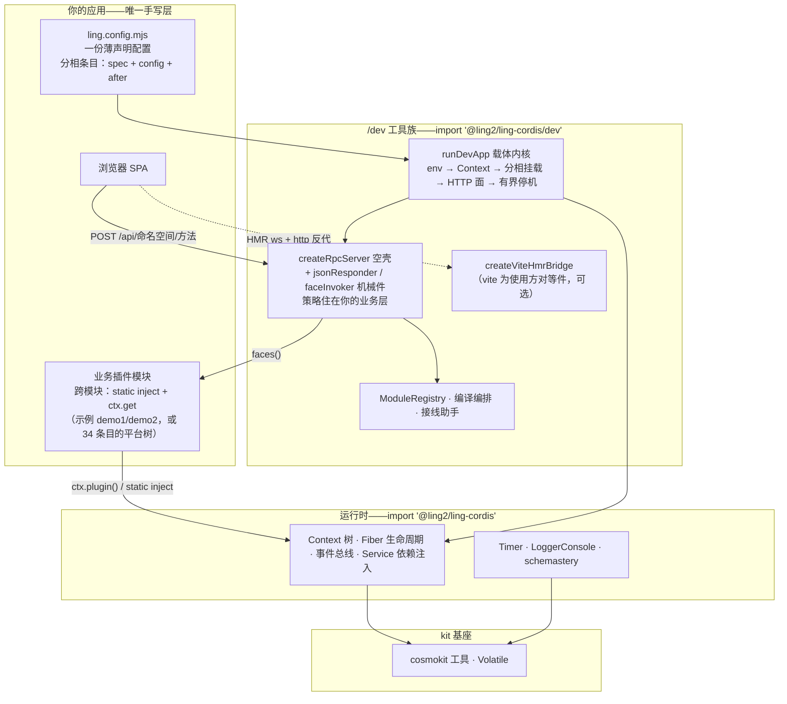

# ling-cordis

独立发布的 [cordis](https://github.com/koishijs/cordis) 血统 TypeScript 插件运行时：可组合的**上下文**、生命周期受管的**插件 Fiber**、带类型的**事件总线**、**依赖注入服务**、**定时器**混入、**Schema** 校验（schemastery）与控制台**日志**——单包 ESM 交付，安装即用。

> English documentation: [README.md](./README.md)。

## 特性

- **上下文树**——代理式依赖容器，原型链作用域派生（`extend` / `isolate` / `intercept`）。
- **Fiber**——每个插件跑在独立 Fiber 里：epoch 制 reload/unload、effect 清理、启动前配置校验。
- **事件总线**——五种分发模式（`emit` / `parallel` / `serial` / `bail` / `waterfall`），经模块增强获得类型化事件表。
- **服务**——挂在 `ctx` 上的具名 API（`ctx.get(name)`）、`@Inject()` 装饰器、可调用服务、intercept 配置链。
- **定时器**——`ctx.timeout` / `interval` / `throttle` / `debounce`，全部由所属 Fiber 持有、随其撤销。
- **Schema**——schemastery 构建器：声明式配置模式、standard-schema v1 接口、`Volatile` 稳定引用配置。
- **控制台日志**——分级输出、着色、diff 后缀、按名取色。

## 架构分层

四层——**你只写最顶层，其余三层都在包里**：



- **你的应用**——一份配置 + 插件模块；跨模块调用后端走 `static inject` + `ctx.get`，前端走换命名空间。
- **/dev 工具族**——dev 服务器绕运行时之外的一切：载体内核、JSON-RPC 网关、vite HMR 桥、注册表/编译/接线助手。
- **运行时**——本包发布的 cordis 血统内核。
- **kit 基座**——零依赖工具箱，运行时建于其上。

## 环境要求

- Node.js **≥ 22**（用到 `Promise.withResolvers`）
- 仅 ESM（`"type": "module"`）；浏览器日志入口以源码形态保留，不在发布入口内

## 安装

```bash
npm install @ling2/ling-cordis
# 或：pnpm add @ling2/ling-cordis
```

## 快速上手

```ts
import { Context, LoggerConsole, Service, Timer } from '@ling2/ling-cordis'

// 插件即服务：具名 'hello'，暴露为 ctx.hello
class Hello extends Service {
  static inject = [] as const
  constructor(ctx: Context) {
    super(ctx, 'hello')
    // Timer 插件装配后 ctx 上就有定时混入；effect 随所属 Fiber 一并撤销
    ctx.setInterval(() => ctx.logger('hello').info('tick'), 1000)
  }
  greet(name = 'world') {
    return `hello, ${name}!`
  }
}

const ctx = new Context()
await ctx.plugin(LoggerConsole, { colors: false })
await ctx.plugin(Timer)
await ctx.plugin(Hello)

ctx.logger('app').info(ctx.get('hello').greet('cordis'))
await ctx.fiber.dispose() // 执行全部已登记的 effect
```

可运行版本见 [`examples/hello`](./examples/hello)（`pnpm smoke`）。

## 开发工具族（`/dev`）

`/dev` 子出口承载"装配 + 开发工作流"工具族——一份注册表同时驱动模块挂载、
浏览器产物静态表与编译编排；外加代管的 vite 子进程，让 dev 服务器不改端口
就获得前端 HMR：

```ts
import { ModuleRegistry, buildRegisteredModules, createViteHmrBridge } from '@ling2/ling-cordis/dev'

// ① 一份注册表三处消费（挂载 / 静态表 / 编译）
const registry = new ModuleRegistry(['core', 'tail'])
registry.add({
  id: 'my-plugin', phase: 'tail', note: '示例模块',
  client: { key: 'my-plugin/client.js' },        // → 静态通道表条目
  mount: async (ctx, env) => { await ctx.plugin(MyPlugin, { env }) },
})
for (const mod of registry.ofPhase('core')) await mod.mount?.(ctx, env)

// ② vite dev 子进程：HTTP 反代 + WebSocket 升级透传
const hmr = createViteHmrBridge({ cwd: 'web-app', port: 5174 })
await hmr.ready
// http 处理器：   if (!hmr.proxyHttp(req, res, req.url)) 走静态 dist
// 'upgrade' 事件：if (!hmr.proxyUpgrade(req, socket, head)) socket.destroy()
// hmr.port === 0 = 未激活（vite 缺席 / 子进程退出）→ 回落静态产物

// ③ 按注册表编译：全量 / 指名 / 载体特名 / skipCarrier
buildRegisteredModules({ registry, rootDir, carrier: { id: 'web', cwd: 'web-app', script: 'build' } })
```

认领顺序归你：桥从不接管你的服务器——由你调用 `proxyHttp` / `proxyUpgrade`，
其他处理器（认证、桥、静态面）仍在你手里排在前面。vite 是使用方的对等件，
本包零新增依赖。

**或者干脆不接线**——`runDevApp` 把一份声明式配置直接跑成整个 dev 服务器
（`vite.config.ts` 式薄配置体验）：

```ts
import { defineApp, runDevApp } from '@ling2/ling-cordis/dev'

const config = defineApp({
  rootDir: import.meta.dirname,
  port: 3000,
  hmr: { cwd: 'web-app' },
  staticApp: { root: 'web-app/dist' },
  phases: ['base', 'core', 'engine', 'tail'],
  modules: [
    { id: 'my-plugin', phase: 'tail', spec: './src/my-plugin.ts',
      client: { key: 'my-plugin/client.js' }, config: { port: 1 } },
  ],
  http: (ctx) => [{ handle: myGateway(ctx), healthz: () => ({ faces: 3 }) }],
})
await runDevApp(config) // env → Context → 相循环 → HTTP+HMR+静态 → 有界停机
```

条目经动态 `import(spec)` + `ctx.plugin` 挂载（class 插件加 `use: 'default'`），
复杂接线走 `after` 钩子；`loadEnv`/注册表/编译编排/接线助手凑齐整套工具族。
内核不读任何环境变量——开关与端口全部以普通配置值传入。

完整可跑演示见 [`examples/dev-app`](./examples/dev-app)：`pnpm demo` 起服
（浏览器开 http://127.0.0.1:8390/）；`pnpm demo:check` 一条命令自检全链
（登录 → RPC 参数绑定 → 会话门 → healthz → 静态 SPA）即退——验货最快路径。

**网关是空壳，一切策略都是你的层。** `createRpcServer` 只做 koa 式洋葱组合——
零路由假设、零协议形状、零自动挂载。显式排层组合：包内机械件（`jsonResponder`
——最外层应答汇；`faceInvoker`——最内层 `POST /api/<ns>/<method>` 分派+按名
绑参），中间夹你的业务层（auth 三端点、会话门、审计、日志）。**层序即语义**：
审计件排在 invoker 之外=发送前改写 value 的最后一站；嵌套天然支持（ALS 型
请求上下文传播=中间件包 `next()`）。层对象可挂 `onInit`/`onReady`/`onDestroy`，
经 `createRpcFace` 与 `runDevApp` 挂件槽派发。`examples/dev-app` 里整套 auth
三端点+会话门是演示自持的 ~40 行中间件——这就是策略件应有的形态。

## 模块

| 路径 | 内容 | 上游来源 |
| --- | --- | --- |
| `src/core` | 上下文/Fiber/事件/注册表/服务/日志 | cordis |
| `src/kit` | 数组/字符串/时间/类型工具，`Volatile` 机制 | cosmokit |
| `src/schema` | 可调用 Schema 构建器与校验 | schemastery |
| `src/plugins/timer.ts` | 定时混入插件 | cordis-plugin-timer |
| `src/plugins/logger-console` | 控制台导出器插件 | cordis-plugin-logger-console |
| `src/dev` | 开发工具族：模块注册表 / vite HMR 桥 / 编译编排 | 原创（本仓） |

## 概念

- **Context**——根容器与作用域工厂：服务、配置层、隔离标签都挂在上面；子作用域经原型链继承。
- **Fiber**——一次插件激活：setup 栅栏、effect（清理器/承诺/迭代器）、epoch 制 `restart()` / `update()`。
- **Service**——`ctx` 上的具名单例 API（`ctx.get('hello')`）；用 `static inject` 或 `@Inject()` 装饰器声明依赖。
- **Events**——监听器是 Fiber 持有的 effect；增强全局 `Events` 接口即可为自己的事件获得类型。
- **Schema**——用 `z.object({ port: z.number().default(3000) })` 描述插件 `Config`；Fiber 启动前完成校验。

## 开发

```bash
pnpm install
pnpm typecheck   # tsc --noEmit
pnpm test        # vitest（74 例）
pnpm build       # tsdown 打包 JS + tsc 直出 d.ts 模块树
pnpm check:dts   # 以外部消费者视角编译 dist 类型冒烟
pnpm smoke       # 端到端启动 examples/hello
```

## 许可与致谢

MIT——见 [LICENSE](./LICENSE)。本项目承接 Shigma 的 cordis 生态血脉（经内部
`@deepseek-ai/*` fork 中转）；完整来源链与模块对照见 [NOTICE.md](./NOTICE.md)。
