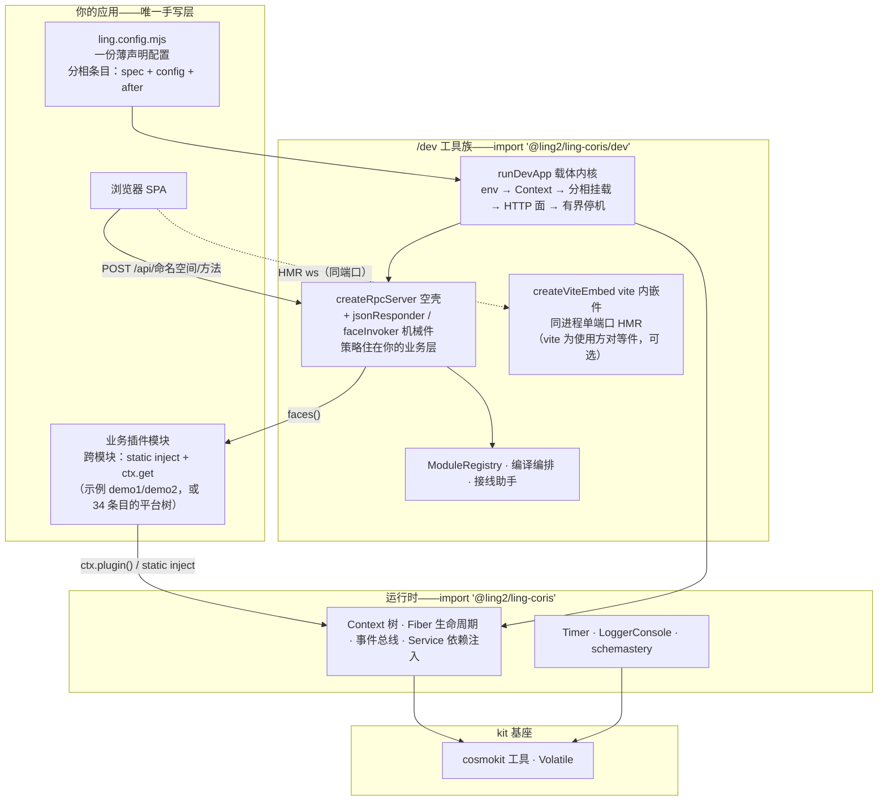

# ling-coris

独立发布的 [cordis](https://github.com/koishijs/cordis) 血统 TypeScript 插件运行时：可组合的**上下文**、生命周期受管的**插件 Fiber**、带类型的**事件总线**、**依赖注入服务**、**定时器**混入、**Schema** 校验（schemastery）与控制台**日志**——单包 ESM 交付，安装即用。

> English documentation: [README.md](./README.md)。

## 特性

- **上下文树**——代理式依赖容器，原型链作用域派生（`extend` / `isolate` / `intercept`）。
- **Fiber**——每个插件跑在独立 Fiber 里：epoch 制 reload/unload、effect 清理、启动前配置校验。
- **事件总线**——五种分发模式（`emit` / `parallel` / `serial` / `bail` / `waterfall`），经模块增强获得类型化事件表。
- **服务**——挂在 `ctx` 上的具名 API（`ctx.get(name)`）、`@Inject()` 装饰器、可调用服务、intercept 配置链。
- **定时器**——`ctx.timeout` / `interval` / `throttle` / `debounce`，全部由所属 Fiber 持有、随其撤销。
- **Schema**——schemastery 构建器：声明式配置模式、standard-schema v1 接口、`Volatile` 稳定引用配置。
- **控制台日志**——分级输出、着色、diff 后缀、按名取色。

## 名词解释（统一说法）

| 名词 | 定位 |
| --- | --- |
| **宿主壳**（host） | 常驻浏览器外壳页（`index.html`+装载器）——只提供容器与装载面，不含业务界面 |
| **子应用**（subapp） | 被装载的**物**：一个业务包的浏览器半区（包自带 client 产物，一个 JS 文件），经子应用协议注册进宿主并自行挂载 UI。对位 qiankun 子应用 / VS Code webview |
| **座位**（slot） | 宿主侧**挂载位**=装载到的**位**（dsh 宿主的子应用/座位体系）：子应用挂到页面哪个位置由座位定。子应用与座位是两个名词，勿混称 |
| **子应用协议** | 注册面 `window.__ModuleLoader__.load({id, factory})` + factory 交出 `{inject, apply}` 的激活约定 |
| **子应用键** | ling.config.mjs 模块条目的 `client.key`——子应用的装载名与 `/packages` 通道键，自动装载键序的唯一来源 |
| **装载器** | 框架路由 `/__ling/boot.js`：装载面缺省实现 + `lingLoadSubapps`（自持装载宿主用） |
| **自动装载** | 框架路由 `/__ling/main.js`：装载器 + 按模块清单键序自动装载，标准项目宿主页一行引它 |
| **`/packages` 通道** | 子应用下发口：dev 态发源码 shim（HMR 生效），产物态发 `client/client.js` |
| **壳/子应用产物** | `dist/`=vite build 出的宿主页静态资产；`client/client.js`=`buildClientBundle` 出的子应用注册器（均不入库） |

## 架构分层

四层——**你只写最顶层，其余三层都在包里**：



- **你的应用**——一份配置 + 插件模块；跨模块调用后端走 `static inject` + `ctx.get`，前端走换命名空间。
- **/dev 工具族**——dev 服务器绕运行时之外的一切：载体内核、JSON-RPC 网关、vite HMR 桥、注册表/编译/接线助手。
- **运行时**——本包发布的 cordis 血统内核。
- **kit 基座**——零依赖工具箱，运行时建于其上。

## 环境要求

- Node.js **≥ 22**（用到 `Promise.withResolvers`）
- 仅 ESM（`"type": "module"`）；浏览器日志入口以源码形态保留，不在发布入口内

## 安装

```bash
npm install @ling2/ling-coris
# 或：pnpm add @ling2/ling-coris
```

## 快速上手

```ts
import { Context, LoggerConsole, Service, Timer } from '@ling2/ling-coris'

// 插件即服务：具名 'hello'，暴露为 ctx.hello
class Hello extends Service {
  static inject = [] as const
  constructor(ctx: Context) {
    super(ctx, 'hello')
    // Timer 插件装配后 ctx 上就有定时混入；effect 随所属 Fiber 一并撤销
    ctx.setInterval(() => ctx.logger('hello').info('tick'), 1000)
  }
  greet(name = 'world') {
    return `hello, ${name}!`
  }
}

const ctx = new Context()
await ctx.plugin(LoggerConsole, { colors: false })
await ctx.plugin(Timer)
await ctx.plugin(Hello)

ctx.logger('app').info(ctx.get('hello').greet('cordis'))
await ctx.fiber.dispose() // 执行全部已登记的 effect
```

可运行版本见 [`examples/hello`](./examples/hello)（`pnpm smoke`）。

## 开发工具族（`/dev`）

`/dev` 子出口承载"装配 + 开发工作流"工具族——一份注册表同时驱动模块挂载、
浏览器产物静态表与编译编排；外加**同进程单端口**的 vite 内嵌件，让 dev 服务器
不另开端口、不起子进程就获得前端 HMR（含 React Fast Refresh）：

```ts
import { ModuleRegistry, buildRegisteredModules, createViteEmbed } from '@ling2/ling-coris/dev'

// ① 一份注册表三处消费（挂载 / 静态表 / 编译）
const registry = new ModuleRegistry(['core', 'tail'])
registry.add({
  id: 'my-plugin', phase: 'tail', note: '示例模块',
  client: { key: 'my-plugin/client.js' },        // → 静态通道表条目
  mount: async (ctx, env) => { await ctx.plugin(MyPlugin, { env }) },
})
for (const mod of registry.ofPhase('core')) await mod.mount?.(ctx, env)

// ② vite 内嵌 HMR（同进程同端口）：vite 以库形态从 cwd/node_modules 加载、
//    middlewareMode 进程内常驻——HMR ws 挂你自己的 http 服务，无独立 vite 端口；
//    缺席/越界 fail loud 拒启（禁静默回落 dist；逃生口 enabled:false 归你组合）
const embed = await createViteEmbed({ cwd: 'web-app', httpServer, react: true })
server.on('upgrade', (req, socket) => {
  if (embed.claimsUpgrade(req)) return          // vite-hmr 协议头+base 路径=vite 认领
  socket.destroy()
})
// HTTP 面上把 /app/* 交给 embed.middlewares（next()=未认领，显式报错勿回落）

// ③ 按注册表编译：全量 / 指名 / 载体特名 / skipCarrier
buildRegisteredModules({ registry, rootDir, carrier: { id: 'web', cwd: 'web-app', script: 'build' } })
```

认领顺序归你：内嵌件从不接管你的服务器——HTTP 面与 upgrade 链仍在你手里，
vite 只收它认领的 `/app` 页面与 HMR ws 升级。vite（与 `react:true` 时的
`@vitejs/plugin-react`）是使用方的对等件，本包零新增依赖。

**或者干脆不接线**——`runDevApp` 把一份声明式配置直接跑成整个 dev 服务器
（`vite.config.ts` 式薄配置体验）：

```ts
import { defineApp, runDevApp } from '@ling2/ling-coris/dev'

const config = defineApp({
  rootDir: import.meta.dirname,
  port: 3000,
  hmr: { cwd: 'web-app', react: true },   // 同进程单端口 vite 内嵌；零 vite.config（见下节）
  staticApp: { root: 'web-app/dist' },    // 仅产物形态消费（dev 形态 /app 全权交 vite，禁回落）
  phases: ['base', 'core', 'engine', 'tail'],
  modules: [
    { id: 'my-plugin', phase: 'tail', spec: './src/my-plugin.ts',
      client: { key: 'my-plugin/client.js' }, config: { port: 1 } },
  ],
  http: (ctx) => [{ handle: myGateway(ctx), healthz: () => ({ faces: 3 }) }],
})
await runDevApp(config) // env → Context → 相循环 → HTTP+HMR+静态 → 有界停机
```

条目经动态 `import(spec)` + `ctx.plugin` 挂载（class 插件加 `use: 'default'`），
复杂接线走 `after` 钩子；`loadEnv`/注册表/编译编排/接线助手凑齐整套工具族。
内核不读任何环境变量——开关与端口全部以普通配置值传入。

**`phases`=挂载相表**：声明相的先后顺序，条目挂进哪相由其 `phase` 字段指定——
内核按相序逐相挂载、相内按登记序。「先基座后业务、引擎晚于核心」这类顺序
约定用相表表达，相名自由命名（上例 `base/core/engine/tail`；单相小应用
`['only']`、`ling-harness-runner` 的 `['engine']` 皆常见）。跨相依赖不必靠
排相——插件 `static inject` 声明依赖即得等侍语义，挂载顺序与依赖解耦
（`examples/dev-app` 的 demo2 在 tail 相依赖 core 相的 demo1 即证）。

完整可跑演示见 [`examples/dev-app`](./examples/dev-app)：`pnpm demo` 起服
（浏览器开 http://127.0.0.1:8390/）；`pnpm demo:check` 一条命令自检全链
（登录 → RPC 参数绑定 → 会话门 → healthz → 静态 SPA）即退——验货最快路径。

### 前端 HMR（vite 内嵌，同进程单端口）

`hmr` 一行 + 宿主页一行，就是全部接入（术语见「名词解释」）。

- **配置侧**：`hmr: { cwd: <vite 工程根>, react: true }`——简单使用方零
  vite.config（框架自备 `@vitejs/plugin-react`、合成 `base:'/app/'` 与依赖预热）；
  自带 `vite.config.ts` 的复杂使用方不设 `react:true`（插件双开禁）。
- **站点前缀单源**：`basePath: '/app'`（可选，缺省即此值）——`staticApp.urlPrefix`
  与 vite `base` 未显式设置时都由它派生（防两处各写一份、改一漏一=资产 404 无提示）；
  显式设置保留、越具体越优先；尾斜杠容错（`'/foo/'` 归一 `'/foo'`）。
- **宿主页侧**：`index.html` 只引一行 `<script src="/__ling/main.js"></script>`
  （子应用键序=ling.config.mjs 模块清单）。自持装载宿主（如 ling-web client-kernel）
  改用两行式：`<script src="/__ling/boot.js">` + 内联
  `<script>lingLoadSubapps(['键'])</script>`。**禁**直引 `/packages/*`、内联
  `type="module"`、静态 `import` 框架脚本。
- **子应用侧**：模块条目带 `client: { key }` 且包内有约定入口
  （`src/client/index.tsx|.ts`）——dev 态 `/packages/<key>` 直供源码（HMR 生效），
  产物态同键发 `client/client.js`。
- **语义规约**：①组件与 `apply`/`inject` 协议导出**分模块**（混出=热更丢状态）；
  ②React `StrictMode` 下装载后首次热更重挂载一次（其后正常）。

可跑样 [`examples/hmr-react`](./examples/hmr-react)——ling-web 形态（标准
`vite.config.ts` + 项目标配三命令，包内 `pnpm install --ignore-workspace` 后）：

| 命令 | 角色 |
| --- | --- |
| `pnpm dev` | 开发环境（HMR）：vite 内嵌同进程单端口起服，开 `/app/` 改 `src/client/DemoView.tsx` 即时热更；`--check` 跑 5 项自检 |
| `pnpm build` | 编译产物两件：壳 `dist/`（vite build）+ 子应用 `client/client.js`（框架件 `buildClientBundle` 包成子应用协议注册器） |
| `pnpm start` | 产物启动：吃 build 产物、无 vite，同一页面同一装载面；`--check` 自检 |

另一消费范本=`ling-harness-runner`（容器形态：与 sample 同款三命令与源码直载
规范，`pnpm start` 同源 `--product` 跑产物档，无 bundle 形态；零 vite.config
形态（`react:true`）暂无独立样例——能力保留，简单使用方按上节配置侧说明即用）。

### 构建与检查（同样一行接入）

- **子应用产物**：`buildClientBundle({ entry, id })`——esbuild 打包成子应用协议注册器，
  产物位缺省 `<包>/client/client.js`（esbuild 使用方自备）。
- **多子应用宿主须共享 React 单例**（O6 防线）：`buildClientBundle` 缺省全内联（单面板
  最小样合理）；多面板宿主每包内联一份 React=体积膨胀×N 且跨面板 hooks 互操作全断
  （context/portal 不同实例）——多面板项目用 `esbuild: { external: ['react',
  'react-dom'] }` 外置、宿主页自备全局 React。产物超 512KB 打 WARN 提醒核查
  （`warnBytes` 可调）；dev 态无此问题（vite 模块图天然单 React）。
- **构建编排**：`buildRegisteredModules({ registry, rootDir, carrier })`——逐包
  `build:client` + 载体壳目标（`vite build`）；范本=`examples/hmr-react` 的 `pnpm build`。
- **类型检查编排**：`runCheckScripts({ targets })` / `checkRegisteredModules`——
  逐包跑 `check` 脚本、聚合报告（败不抛）。
- **主题门**：`themeGate({ tokenSheets, bundles, allowedVars, allowedPrefixes,
  skipBundleE3Prefixes, strict })`——E1 幽灵 token / E2 主题名硬编码 / E3 浅底 /
  strict 硬编码色；`stripCommentsLine` / `printThemeGateResult` 一并出口（消费
  范本=bsh 树 theme-guard）。
- **路径规约**：一律 `node:path` / `pathToFileURL`（Linux/Windows 双兼容），禁盘符
  字面拼接。

**网关是空壳**：`createRpcServer` 只做洋葱组合——层序=`jsonResponder`（最外应答
汇）→ 你的业务层（auth 三端点/会话门/审计/日志）→ `faceInvoker`（最内
`POST /api/<ns>/<method>` 分派+按名绑参）；层对象可挂 `onInit`/`onReady`/
`onDestroy`。范本=`examples/dev-app` 自持的 ~40 行 auth+会话门中间件。

### 标准项目结构（ling-web 形态）

接入本框架的标准消费者包长什么样——[`examples/hmr-react`](./examples/hmr-react)
与消费范本 `ling-harness-runner` **逐文件同构**，下树即规范：新接入包照此起形，
与树不一致=要翻旧账（`engines.json`/`entrypoint.sh` 等仍是域增量件；**Dockerfile
三件套已有正典模板**，见下节「容器化」）：

```
<包根>/
├── ling.config.mjs        # 装配声明（唯一组合源）：模块清单+相表；dev=嵌 HMR，产物态=吃 dist 静态
├── boot.mjs               # 启动器：import 配置 → runDevApp；dev/产物两态共用；--check 自检即退
├── build.mjs              # pnpm build 入口：viteBuild 出壳 dist/ + buildClientBundle 出子应用产物
├── vite.config.ts         # 标准 vite 配置（base '/app/' + react 插件）——复杂使用方必带，简单使用方可省
├── index.html             # 宿主页：唯一职责 = 容器 #root + <script src="/__ling/main.js">（子应用装载收归框架）
├── src/
│   └── client/
│       ├── index.tsx      # 子应用协议出口 export { inject, apply }——/packages 源码面约定入口
│       └── DemoView.tsx  # 纯 React 组件与业务源码（与协议出口分文件 = Fast Refresh 保状态）
├── Dockerfile             # 【容器件·可选】多阶段镜像正典模板（构建期全量 devDeps→运行期仅产物+框架包）
├── compose.yaml           # 【容器件·可选】编排样例（HOST=0.0.0.0 环境注入）
├── dist/                  # 【产物·不入库】壳静态资产（vite build 产出；产物态 staticApp 服务根）
├── client/
│   └── client.js          # 【产物·不入库】子应用协议注册器（buildClientBundle 产出；产物态 /packages 通道）
└── package.json           # 三命令标配 dev/build/start + 对等件 devDeps（vite/react/esbuild/tsx）
```

逐文件作用与属地（**约定**=路径/职责框架定、不可换名；**你的**=内容业务自持）：

| 文件 | 作用 | 属地 |
| --- | --- | --- |
| `ling.config.mjs` | 唯一组合源：模块清单（id/phase/client/mount）、dev 态 `hmr` 一行、产物态 `staticApp` 切换 | 路径=约定，内容=你的 |
| `boot.mjs` | 启动器：读配置 → `runDevApp`；`--check` 自检即退 | 同上 |
| `build.mjs` | `pnpm build` 入口：壳+子应用双目标编译 | 同上 |
| `vite.config.ts` | 标准 vite 配置（`base '/app/'`+react 插件）；简单使用方可省（`hmr.react:true` 框架内联合成） | 可选件 |
| `index.html` | 宿主页：`#root` 容器+一行经典 script 引 `/__ling/main.js`；**勿**直引子应用或内联装载逻辑 | 唯一 html，入构建图 |
| `src/client/index.tsx` | 子应用协议出口 `export { inject, apply }`；**禁**与组件混出（混出热更走重挂载丢状态） | 约定入口 |
| `src/client/*.tsx` | 纯组件与业务源码——热更保状态的本体 | 你的 |
| `Dockerfile`/`compose.yaml`/`.dockerignore` | 容器化三件套（可选；正典模板随示例，见下节） | 模板即抄，业务可改 |
| `dist/`、`client/client.js` | 构建产物两件（壳/子应用） | 产物，不入库 |

**装载规约**：宿主页装载接线只有一行 `<script src="/__ling/main.js">`；子应用键序
唯一来源=ling.config.mjs 模块清单 `client.key`（packagesExtras 共享件不自动装载）。

### 容器化（Docker）

标准消费者镜像的正典=[`examples/hmr-react/Dockerfile`](./examples/hmr-react/Dockerfile)
（2026-10-26 架构评审 O4 + 裁-2/裁-3 裁定形态）：**多阶段**——构建期装全量 devDeps
（vite/esbuild/plugin-react）并把三处演示形态相对 import 重写为 `@ling2/ling-coris/dev`
包出口（与真实使用方一字不差）；运行期仅产物（`dist/`+`client/`）+钉版本框架包
（`pnpm install --prod`），vite/esbuild/tsx 不进镜像。三件现成容器适配：`/healthz`
内建路由配 `HEALTHCHECK`、SIGTERM 触发有界停机（`docker stop` 干净收敛）、`HOST=0.0.0.0`
由 `ling.config.mjs` 薄壳读 env（框架 `/dev` 零 env 纪律不破）。

```bash
cd examples/hmr-react
docker build -t ling-coris/hmr-react:latest .          # 日常档（框架包= npm latest）
docker build --build-arg LING_CORIS_VERSION=2.3.0 \
  -t ling-coris/hmr-react:2.3.0 .                      # 钉版档（正式发布用）
docker run -d --name ling-hmr-react -p 8391:8391 \
  -e HOST=0.0.0.0 ling-coris/hmr-react:2.3.0            # 起容器（非 root 运行）
```

发布流水线（裁-6：本地脚本编排、构建与验证在部署机完成，不走云端发布）：
`node scripts/release.mjs all` 一发全串——门禁四连→发 npm→推双远端→部署机
docker build（钉新版本）→重建容器→探活三断言；各节点可单步跑（`gates`/`publish`/
`push`/`remote`/`run`/`verify`），`--dry-run` 保护外发动作。凭据读 `.env`
（`npmjs_access_token`/`DEPLOY_SSH_*` 等，gitignored）。

## 模块

| 路径 | 内容 | 上游来源 |
| --- | --- | --- |
| `src/core` | 上下文/Fiber/事件/注册表/服务/日志 | cordis |
| `src/kit` | 数组/字符串/时间/类型工具，`Volatile` 机制 | cosmokit |
| `src/schema` | 可调用 Schema 构建器与校验 | schemastery |
| `src/plugins/timer.ts` | 定时混入插件 | cordis-plugin-timer |
| `src/plugins/logger-console` | 控制台导出器插件 | cordis-plugin-logger-console |
| `src/dev` | 开发工具族：模块注册表 / vite 内嵌 HMR / 客户端源码面 / 框架装载器 / 编译编排 | 原创（本仓） |

## 概念

- **Context**——根容器与作用域工厂：服务、配置层、隔离标签都挂在上面；子作用域经原型链继承。
- **Fiber**——一次插件激活：setup 栅栏、effect（清理器/承诺/迭代器）、epoch 制 `restart()` / `update()`。
- **Service**——`ctx` 上的具名单例 API（`ctx.get('hello')`）；用 `static inject` 或 `@Inject()` 装饰器声明依赖。
- **Events**——监听器是 Fiber 持有的 effect；增强全局 `Events` 接口即可为自己的事件获得类型。
- **Schema**——用 `z.object({ port: z.number().default(3000) })` 描述插件 `Config`；Fiber 启动前完成校验。

## 开发

```bash
pnpm install
pnpm typecheck   # tsc --noEmit
pnpm test        # vitest（109 例）
pnpm build       # tsdown 打包 JS + tsc 直出 d.ts 模块树
pnpm check:dts   # 以外部消费者视角编译 dist 类型冒烟
pnpm smoke       # 端到端启动 examples/hello
```

## 许可与致谢

MIT——见 [LICENSE](./LICENSE)。本项目承接 Shigma 的 cordis 生态血脉（经内部
`@deepseek-ai/*` fork 中转）；完整来源链与模块对照见 [NOTICE.md](./NOTICE.md)。
